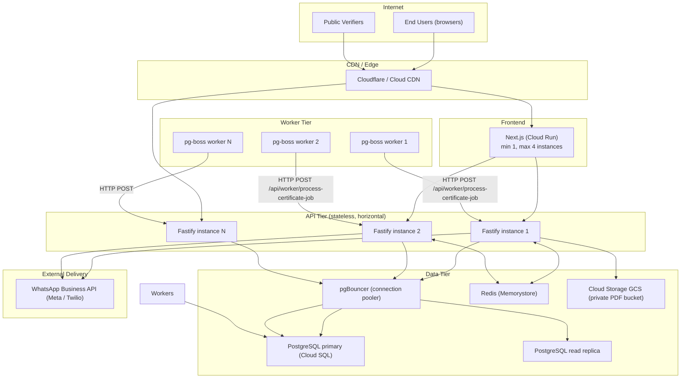

# CertiFlow — Production Deployment Plan

This is a plan. Nothing described here is currently deployed. The goal is to serve 100,000 registered users, approximately 10,000 daily active users, and a peak load of 500 batch approvals in one hour (roughly 30,000 PDFs and 30,000 WhatsApp messages in that hour).

---

## Load Model

| Metric | Value | Derivation |
|---|---|---|
| Registered users | 100,000 | Given |
| Daily active users | ~10,000 | Given |
| Peak: batches approved in 1 hour | 500 | Given |
| Peak PDFs in 1 hour | 30,000 | Given directly |
| Sustained PDF rate | ~8.3 PDFs/s | 30,000 / 3,600 s |
| Burst PDF rate (all 500 batches in 10 min) | ~50 PDFs/s | 30,000 / 600 s |
| Sustained WhatsApp message rate | ~8.3 msg/s | Same as PDFs — one message per certificate |
| Public verify lookups | Thousands/day in bursts | Assumed peak: ~100 req/s during announcement windows |

---

## Architecture

---

## Hosting Per Component

| Component | Hosting | Why |
|---|---|---|
| Next.js web | Cloud Run (min 1, max 4 instances) | Stateless SSR; auto-scales on HTTP load; no persistent state needed |
| Fastify API | Cloud Run (min 2, max 10 instances) | Stateless; horizontal scaling is straightforward; min 2 for availability |
| pg-boss worker | Cloud Run (min 1, max 20 instances) | Multiple worker instances safely share the pg-boss queue via DB; singleton job keys prevent double-issuance |
| PostgreSQL | Cloud SQL (Postgres 16, `db-standard-4`, 100 GB SSD, HA) | Managed backups, automatic failover, IAM auth, private VPC |
| Connection pooler | pgBouncer (sidecar or managed) | Keeps DB connections under the ~200 limit even with many API instances |
| Redis | Memorystore for Redis (1 GB standard tier) | Managed, same VPC, low latency; used for pub/sub and verify cache |
| PDF files | Cloud Storage (private bucket) | Durable, cheap, access-controlled; replaces local filesystem |
| WhatsApp delivery | Meta WhatsApp Business API or Twilio | Real delivery; the mock server is not suitable for production |

---

## Scaling Analysis

### PDF Generation

PDFKit is CPU-bound and synchronous per certificate. A single Node.js worker instance can generate approximately 5–10 PDFs per second.

> **This estimate is not benchmarked.** Measure on the actual target instance type before launch.

| Scenario | PDFs/s needed | Worker instances needed (est.) |
|---|---|---|
| Sustained (8.3/s) | 8.3 | 1–2 |
| Moderate burst (50/s, all batches in 10 min) | 50 | 6–10 |
| Extreme burst (all in 5 min) | ~100/s | 12–20 |

The backlog clears because pg-boss retains jobs until they succeed. Workers auto-scale via Cloud Run's concurrency settings. After the burst, the queue drains at the sustained rate.

### WhatsApp Delivery

The WhatsApp Business API throughput limit depends on tier and phone number registration. Meta's standard tier allows roughly 80 messages per second per registered number. At 8.3 msg/s sustained, one registered number is sufficient. At peak burst, the provider rate limit is the bottleneck, not the application. Mitigation: register multiple numbers, or use a provider (e.g. Twilio) that pools capacity.

Failed deliveries are recorded in the `deliveries` table with `status = 'failed'`. A retry job can be added to the pg-boss queue.

### Database Write Path

Each certificate issuance produces approximately 3 DB writes: `INSERT INTO certificates`, `INSERT INTO deliveries`, `UPDATE deliveries SET status`. At 8.3 PDFs/s sustained, that is roughly 25 writes/s — well within PostgreSQL capacity on `db-standard-4`. At 100 PDFs/s burst, it is ~300 writes/s. Connection pooling via pgBouncer is required to stay below the connection limit.

### Public Verify Endpoint

Verify lookups are read-heavy. Redis caches results for 120 s. At 100 req/s burst, most requests are served from Redis with no DB hit. Cache misses go to the PostgreSQL read replica.

---

## Failure Handling

| Failure | Behaviour | Recovery |
|---|---|---|
| Worker crash | pg-boss marks in-flight jobs as failed after the visibility timeout; retries with exponential backoff on restart; singleton job keys prevent double-issuance | Cloud Run restarts the container automatically |
| Redis restart | API falls back to in-memory rate limiting; verify cache goes cold (all requests hit DB temporarily); SSE events are process-local only until Redis reconnects | Memorystore restarts in seconds; connection re-established automatically |
| WhatsApp provider outage | Delivery attempt fails; row in `deliveries` updated to `status = 'failed'`; pg-boss retry policy re-attempts after backoff | Monitor `deliveries` table for failed rows; expose a manual retry endpoint for the state office |
| Slow database | Connection pool exhaustion returns 503 to clients | Scale up Cloud SQL instance; tune pgBouncer pool size; route verify queries to read replica |
| API instance crash | Cloud Run restarts within seconds; in-flight requests fail with 502 from the load balancer | Idempotent operations mean clients can safely retry; the job queue is not lost |
| PDF storage unavailable | Certificate generation fails; job is retried by pg-boss | Use a multi-region GCS bucket; GCS SLA is 99.95% |

---

## Certificate File Storage and Access Control

Replace the local `storage/private/certificates/` path with a private GCS bucket.

- PDFs are written to `gs://<bucket>/certificates/<cert_id>.pdf`.
- The bucket has no public access.
- The API validates the HMAC-SHA256 download token (unchanged from current code) and proxies the file from GCS using a service-account-signed URL valid for 60 s.
- This keeps access control entirely within the application and does not expose GCS bucket names to end users.

> **Not yet implemented:** The GCS proxy endpoint does not exist in the current codebase. It needs to be built.

---

## Monitoring and Alerting

| Signal | Source | Alert condition |
|---|---|---|
| Queue depth | `pgboss.job` table, `state = 'created'` | > 500 jobs waiting for > 10 min |
| Queue age | Oldest `created_on` for active jobs | Job older than 30 min |
| Dead-letter queue size | `pgboss.job` table, `state = 'failed'` | > 10 failed jobs |
| WhatsApp delivery success rate | `deliveries` table: `failed` count / total | Failure rate > 5% in a 5-min window |
| p95 API latency | Cloud Run request metrics | p95 > 2 s on approval or issuance routes |
| 5xx error rate | Cloud Run / load balancer logs | > 1% of requests in 1 min |
| SLA breach count | `batches` table, `escalation_level = 2` | Any new escalation to level 2 |
| DB connection count | Cloud SQL metrics | > 80% of `max_connections` |
| Redis memory usage | Memorystore metrics | > 80% of allocated memory |
| PDF storage usage | GCS bucket metrics | > 80% of storage quota |

Recommended tooling: Google Cloud Monitoring with alerting policies, or Datadog / Grafana for vendor-neutral dashboards.

---

## Rough Monthly Cost Estimates

These are estimates only. Actual costs depend on instance sizing, sustained traffic, egress, and committed-use discounts.

| Component | Hosting | Estimated monthly cost (USD) |
|---|---|---|
| Next.js web | Cloud Run, min 1 × 1 vCPU / 512 MB | $10–30 |
| Fastify API | Cloud Run, min 2 × 1 vCPU / 1 GB | $40–120 |
| pg-boss workers | Cloud Run, min 1 × 1 vCPU / 1 GB, scales to 20 at peak | $30–200 |
| PostgreSQL | Cloud SQL `db-standard-4`, 100 GB SSD, HA | $250–400 |
| pgBouncer | Included as a Cloud SQL feature or $0 sidecar | $0–10 |
| Redis | Memorystore 1 GB standard | $50–80 |
| Cloud Storage (PDF files) | 50 GB stored + download egress | $5–30 |
| WhatsApp API | Twilio or Meta — per-message pricing | $30–150 (at ~30k msg per peak day) |
| Cloud CDN / Cloudflare | Cloudflare free tier or Pro | $0–25 |
| Monitoring | Google Cloud Monitoring | $10–30 |
| **Total** | | **~$425–1,075 / month** |

**Trade-offs:**

- Dropping HA on Cloud SQL cuts ~$100/month but loses automatic failover.
- Using Cloudflare's free tier instead of Google CDN saves $25/month.
- WhatsApp costs depend heavily on the message template category and country.
- Worker cost can be reduced by running them on a small always-on VM (~$30/month) instead of Cloud Run if the burst pattern is predictable and consistent.

---

## Items Not Verified from Code

The following claims in this document are based on design intent rather than verified code paths. Check these before relying on them in production:

1. **Multiple worker instances and pg-boss concurrency** — the code registers handlers with `boss.work()` but was not tested with more than one worker process running simultaneously.
2. **WhatsApp provider rate limits** — the mock WhatsApp server accepts any rate. Real limits depend on the chosen provider tier and must be measured before launch.
3. **PDFKit throughput per instance** — the 5–10 PDFs/s estimate is not benchmarked. Measure on the target Cloud Run instance type before sizing workers.
4. **GCS proxy download** — the current download token is validated by the API, but the GCS proxy implementation does not exist in the codebase. It would need to be built before PDF storage can be moved to GCS.
5. **pgBouncer configuration** — not present in the current `docker-compose.yml`. It would need to be added and tuned before production deployment.
6. **Read replica routing** — the current code uses a single `DATABASE_URL`. Routing verify queries to a read replica requires a code change to use a separate connection string for read-heavy endpoints.
