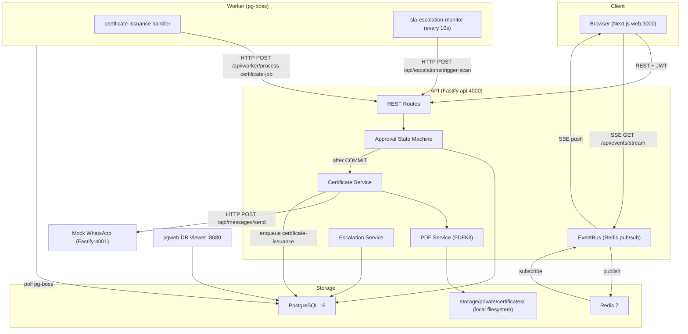

# CertiFlow — Skills Programme Certificate Issuance Platform

## a. Requirements Note

### The Problem

A government skills programme issues certificates to trainees after their batches pass a multi-tier approval process. The process must have an auditable chain of approvals, enforce a quorum of district officers, optionally route large batches through a quality-review team, and deliver certificates to candidates via WhatsApp after final approval. The whole pipeline must be tamper-proof, observable, and fast enough that a live demo can run end-to-end in under a minute.

### Users

| Persona | Role token | Responsibility |
|---|---|---|
| Anika Sharma | `training_centre` | Creates batches, uploads candidates, submits for review, resubmits after send-back |
| Dev Patel, Meera Nair, Kabir Khan | `district_officer` | Reviews and approves/rejects/sends back batches in their assigned district |
| Neha Gupta | `quality_team` | Reviews large batches (≥ threshold) after district approval |
| Farah Siddiqui | `state_office` | Final approval, cancels certificates, monitors stuck batches |
| Public | — | Looks up any certificate by verify code |

### Design Decisions Where the Brief Was Unclear

| Decision | Choice Made | Rationale |
|---|---|---|
| Pipeline stages | `draft → submitted → district_review → quality_review (optional) → state_review → approved → issued` | Covers the most common government workflow; `state_review` is explicit so the state office can reject before issuance |
| "Big batch" threshold | ≥ 50 candidates triggers Quality QA; env var `QUALITY_REVIEW_THRESHOLD`, default `50` | Configurable without a code change; keeps demo fast with small batches |
| District quorum | 2 distinct officers from the same district must both approve | Prevents a single officer from unilaterally advancing a batch; tested in `approvalWorkflow.test.ts` |
| Approvals on send-back and resubmit | `resubmitBatch()` increments the `round` counter. Prior-round approvals stay in the DB scoped by `round`, so they appear in the audit log but do not count toward the new round's quorum | Full audit history; fresh approval slate each round |
| Who can cancel | State Office only; `cancel_reason` is mandatory | Highest authority; immediate Redis cache invalidation |
| SLA reminder delay | 15 s in demo mode (`ESCALATION_REMINDER_SECONDS=15`); configurable | Small default for demo; set to hours in production (e.g. 86400) |
| SLA state escalation delay | 30 s in demo mode (`ESCALATION_STATE_SECONDS=30`); configurable | Same reasoning; production value e.g. 172800 |
| Public verifier sees | `cert_number`, masked candidate name (e.g. `A**** S****`), `course_name`, `issue_date`, `verify_code`, `cancelled_at` if revoked. No phone, no national ID. | Minimum PII exposure |

---

## b. How the System Is Put Together

### Services

| Service | Port | Technology | Purpose |
|---|---|---|---|
| `web` | 3000 | Next.js 14 | Frontend UI with persona switcher; SSE consumer |
| `api` | 4000 | Fastify 4 | REST API, JWT auth, state machine, PDF generation, WhatsApp dispatch |
| `worker` | — | Node.js + pg-boss | Picks up `certificate-issuance` jobs and `sla-escalation-monitor` cron; dispatches to API via HTTP |
| `mock-whatsapp` | 4001 | Fastify | Simulates WhatsApp Business API; has an in-browser inbox UI with controllable latency, failure rate, and outage toggle |
| `postgres` | 5432 | PostgreSQL 16 (Docker) | Primary data store; runs migrations on API start |
| `redis` | 6379 | Redis 7 (Docker) | Pub/sub for SSE, verify-endpoint cache, rate limiting |
| `db-viewer` | 8080 | pgweb (Docker) | Read-only database browser |

> **Note:** The project uses plain PostgreSQL, not Supabase hosted. Migration files live under `supabase/migrations/` for tooling compatibility, but there is no Supabase auth and no Row-Level Security in the migrations.

### Architecture

### Event Flow: "Batch Approved" → "WhatsApp Delivered"

1. State officer posts `POST /api/batches/:id/decision` with `{ "decision": "approve" }`.
2. API opens a transaction: `SELECT ... FOR UPDATE` on the batch row, inserts the approval record, counts approvals for this round and step, advances `status` to `approved` if the quorum is met. Writes `audit_log` and `outbox_events` rows in the same transaction. Commits.
3. After the commit, `CertificateService.processCertificateJob()` is called inline for each candidate.
4. For each candidate: `findOrCreateCertificate()` runs `INSERT ... ON CONFLICT DO UPDATE` (idempotent). `generateCertificatePdf()` builds an A4-landscape PDF with a QRCode pointing to the public verify URL and saves it to `storage/private/certificates/`. SHA-256 of the file is stored in the DB.
5. A delivery row is inserted with an `idempotency_key`. An HMAC-SHA256 download token (7-day expiry) is generated and included in the WhatsApp message.
6. API posts to `http://localhost:4001/api/messages/send` with the idempotency key header. The mock WhatsApp stores the message and returns 200.
7. Delivery row is updated to `delivered` or `failed`.
8. Batch status is updated to `issued`.
9. `EventBus.publish()` fires; Redis pub/sub propagates to all API instances; SSE pushes the event to subscribed browser clients.

The `worker` service handles the same `certificate-issuance` job via pg-boss for production-style processing. The `sla-escalation-monitor` pg-boss cron runs every 10 s and also fires every 15 s via a `setInterval` fallback.

---

## c. Key Technical Decisions

### pg-boss for the job queue

pg-boss stores jobs in the same PostgreSQL database that holds certificates. This means no separate queue infrastructure for the demo. Jobs survive worker crashes. Singleton job keys prevent duplicate issuance. The worker throws on failure, which triggers pg-boss's built-in exponential-backoff retry. Multiple worker instances can consume the same queue safely.

### Redis pub/sub + SSE for live updates

Server-Sent Events are simpler than WebSockets for one-directional server-to-client push. Redis pub/sub on channel `certiflow:events` lets multiple API instances share events. If Redis is unavailable, the EventBus falls back to a local Node.js EventEmitter (events only propagate within the single process). The SSE endpoint (`GET /api/events/stream`) accepts the JWT as a query parameter so browsers can subscribe without custom headers.

### Redis verify cache

`GET /api/certificates/verify/:code` caches results in Redis with a 120 s TTL for found certificates and 30 s for not-found lookups. This keeps burst-time lookup traffic off the database. Certificate cancellation calls `redis.del(cacheKey)` synchronously, so a cancelled certificate is never served from cache.

### Row-lock transaction for concurrent approvals

`approveStep()` runs `SELECT ... FOR UPDATE` on the batch row inside a transaction. A `UNIQUE` constraint on `(batch_id, round, step, officer_id)` in the `approvals` table prevents duplicate votes. Together these mean that two officers submitting approvals at the exact same moment will serialize: one wins the lock, counts approvals, and may advance the batch; the other inserts its approval into the already-advanced batch without double-advancing. An in-memory mutex is used as a secondary guard when Redis is offline.

### Idempotency for certificates and WhatsApp

`findOrCreateCertificate()` uses `INSERT ... ON CONFLICT (candidate_id, course_name) DO UPDATE SET updated_at = now()`. Retrying the issuance step never creates a duplicate certificate. Each WhatsApp send stores an `idempotency_key` in the `deliveries` table; the mock WhatsApp API accepts the key as an `X-Idempotency-Key` header and de-duplicates on its side.

### Append-only audit log

A PostgreSQL `BEFORE UPDATE OR DELETE` trigger on `audit_log` raises an exception, making every row immutable after insert. The API never tries to update or delete audit rows; the trigger is a safety net.

### Stack differences from the brief

The brief suggested a plain React + Express + Supabase stack. This project uses:

- **Next.js 14** instead of plain React — for file-based routing and server components, which simplify the persona-switching demo UI.
- **Fastify 4** instead of Express — for built-in schema validation, TypeScript support, and faster request throughput.
- **Plain PostgreSQL 16 in Docker** instead of Supabase hosted — avoids a cloud dependency for a local demo; migration files are compatible with the Supabase CLI tooling but RLS is not implemented.

---

## d. "Moments That Must Work" and "Things That Must Never Happen"

| Requirement | How it is enforced | Test file |
|---|---|---|
| Two concurrent approvals advance the batch exactly once | `SELECT FOR UPDATE` serializes the transaction; `UNIQUE(batch_id, round, step, officer_id)` blocks duplicate votes; in-memory mutex for offline mode | `approvalWorkflow.test.ts` — "Concurrent approvals via Promise.all" |
| Wrong-district officer is rejected | `verifyOfficerAuthorization()` checks `officer.district_id === batch.district_id`; returns 403 | `approvalWorkflow.test.ts` — "Rejects approvals from wrong role and wrong district" |
| Duplicate officer vote returns 409 | `hasOfficerVoted()` checked before insert | `approvalWorkflow.test.ts` — "already submitted a decision" |
| Send-back requires a reason of at least 5 characters | Zod schema + length check; returns 400 | `approvalWorkflow.test.ts` — "mandatory reason" |
| Reject is terminal — no further transitions | State check raises 409 on any subsequent decision | `approvalWorkflow.test.ts` — "Reject is terminal" |
| Resubmit increments `round`; prior approvals are scoped by round | `resubmitBatch()` increments `round`; `hasOfficerVoted` filters by `round` | `approvalWorkflow.test.ts` — "Send-back and resubmit" |
| 60 candidates, flaky provider → exactly 60 certs, 0 duplicates | Idempotent `findOrCreateCertificate` + idempotency map in provider | `certificateIssuance.test.ts` |
| Cancelling a certificate immediately busts the Redis cache | `redis.del(cacheKey)` called synchronously in `cancelCertificate()` | `certificateIssuance.test.ts` — "Cancel then verify" |
| Download token is tamper-proof and expires | HMAC-SHA256 signed; expiry encoded and verified on each download request | `certificateIssuance.test.ts` — "Unguessable expiring token" |
| SLA escalation fires exactly once per level | `escalation_level` column gates re-triggering; `FOR UPDATE SKIP LOCKED` prevents concurrent duplicate escalations | `escalationAndTrace.test.ts` |
| Formula injection in uploaded CSV/XLSX is sanitised | Values starting with `= + - @` have a `'` prepended before DB insert | `batchCandidateParser.test.ts` |
| All-or-nothing upload | Parser returns errors and saves zero rows on any validation failure | `batchCandidateParser.test.ts` |
| Already-certified candidate is blocked | `findCertifiedPhonesByCourse()` runs before parse; matching phones are rejected | `batchCandidateParser.test.ts` |

---

## e. Security Measures

| Measure | Implementation |
|---|---|
| RBAC | Role, `district_id`, and `centre_id` are read exclusively from the verified JWT payload; never from the request body |
| District boundary check | `verifyOfficerAuthorization()` compares JWT `district_id` against the batch's `district_id` before every approval |
| Token-derived identity | `@fastify/jwt` verifies the token signature; a `dev-fallback-token` shortcut (defaults to Anika's role) is present in the codebase for local dev only |
| Zod schemas | Request bodies are validated with Zod; most schemas use `.strict()` to reject unknown keys |
| Helmet | `@fastify/helmet` sets security headers on every response |
| Rate limiting | 100 requests per 60 s per IP; Redis-backed, falls back to in-memory |
| CORS | Explicit origin allowlist via `CORS_ORIGIN` env var |
| Private PDF storage | PDFs are written to `storage/private/certificates/` with no public URL; download requires a valid HMAC-SHA256 token (7-day expiry) |
| Minimal public verify data | `GET /api/certificates/verify/:code` returns only masked name, course, issue date, cert number, and revocation status — no phone, no national ID |
| Append-only audit log | PostgreSQL trigger blocks `UPDATE` and `DELETE` on `audit_log`; every state change is recorded and cannot be erased |
| **Not implemented** | Row-Level Security (RLS) on database tables. Authorization is enforced at the application layer only. |

---

## f. Observability

| Signal | Implementation |
|---|---|
| Request IDs | Every request gets an `x-request-id` — taken from the incoming header if present, otherwise `crypto.randomUUID()` — and logged as `reqId` in every log line |
| Structured logs | pino logger; pino-pretty in development, JSON in production |
| Swagger UI | `GET http://localhost:4000/docs` — interactive API explorer |
| OpenAPI spec | `GET http://localhost:4000/openapi.json` |
| Liveness | `GET /healthz` or `GET /health/live` — returns uptime and timestamp; always 200 |
| Readiness | `GET /readyz` or `GET /health/ready` — checks DB and Redis connections; returns 503 if either is down |
| Combined health | `GET /health` — returns `healthy` or `degraded` per service |
| Batch trace | `GET /api/batches/:id/trace` (State Office only) — returns `audit_logs`, `deliveries`, and `outbox_events` arrays for a batch |
| Stuck batches | `GET /api/batches/stuck` (State Office only) — lists batches overdue for their current step |

---

## g. AI Usage

> **[TODO: fill in your own AI usage details here]**
>
> Example template:
> - Which parts of the code were written or scaffolded with AI assistance (e.g. Cursor, Copilot, Gemini).
> - How the output was verified (tests run, manual review, fresh-clone smoke test).
> - Any AI-generated content that was rejected or heavily modified and why.

---

## h. Known Bugs, Limitations, and Next Steps

### Bugs

- `accessControlPolicy.ts` — the `can()` helper checks for `batch.status === 'district_approved'` and `'quality_approved'` (old status names). The state machine never sets those statuses. This `can()` check is not called in the hot approval path (the state machine has its own guards), so the bug is dormant but would cause confusion if `can()` were wired to the UI.
- The `dev-fallback-token` shortcut in `auth.ts` defaults to Anika's role and must be removed before any real deployment.

### Limitations

- **No RLS.** Authorization is application-only. A compromised API process can read any row.
- **Local filesystem storage.** PDFs are written to `storage/private/certificates/`. They are lost if the container is recreated without a volume mount. No cloud object storage is wired.
- **Single district, single centre in seed data.** The seed loads one district (Central District) and one training centre (Apex Skills). Multi-district scenarios require manual DB inserts.
- **WhatsApp is mocked.** No real WhatsApp Business API integration exists. The mock server (`mock-whatsapp:4001`) is not suitable for production.
- **No email or SMS fallback.** If WhatsApp delivery fails, the delivery is marked `failed` in the `deliveries` table. There is no retry UI for the training centre or state office.
- **Worker is not auto-started by `npm run dev`.** Running `npm run dev:api` and `npm run dev:web` does not start the worker. Run `npm run dev:worker` separately to process pg-boss jobs.
- **SSE is single-process only when Redis is offline.** If Redis is down, the EventBus falls back to a local EventEmitter. Events are not propagated across multiple API instances.
- **No multi-tenancy.** The system has one government body, one state, and one pool of district officers. The data model does not support multiple states or programmes.
- **SLA times are set to seconds for the demo.** `ESCALATION_REMINDER_SECONDS=15` and `ESCALATION_STATE_SECONDS=30` need to be changed to real values before production use.

### Next Steps

1. Implement RLS policies in migrations.
2. Replace local filesystem storage with S3 or GCS; update the download-token endpoint to proxy from object storage.
3. Integrate a real WhatsApp Business API provider (Meta direct or Twilio).
4. Add an email/SMS fallback for failed WhatsApp deliveries.
5. Build a retry UI for failed deliveries accessible to the state office.
6. Extend seed data to cover multiple districts and centres for more realistic demos.
7. Remove `dev-fallback-token` from `auth.ts` and enforce JWT for all routes in all environments.
