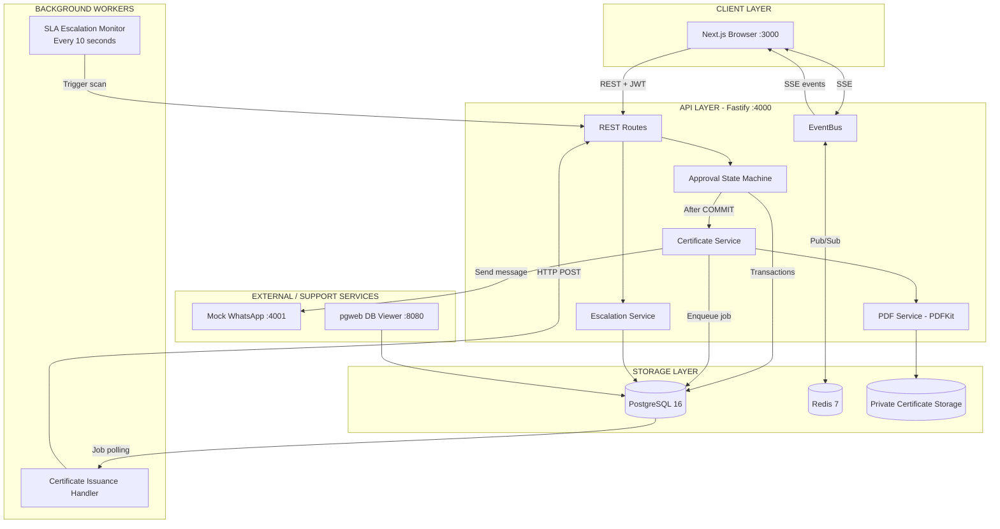
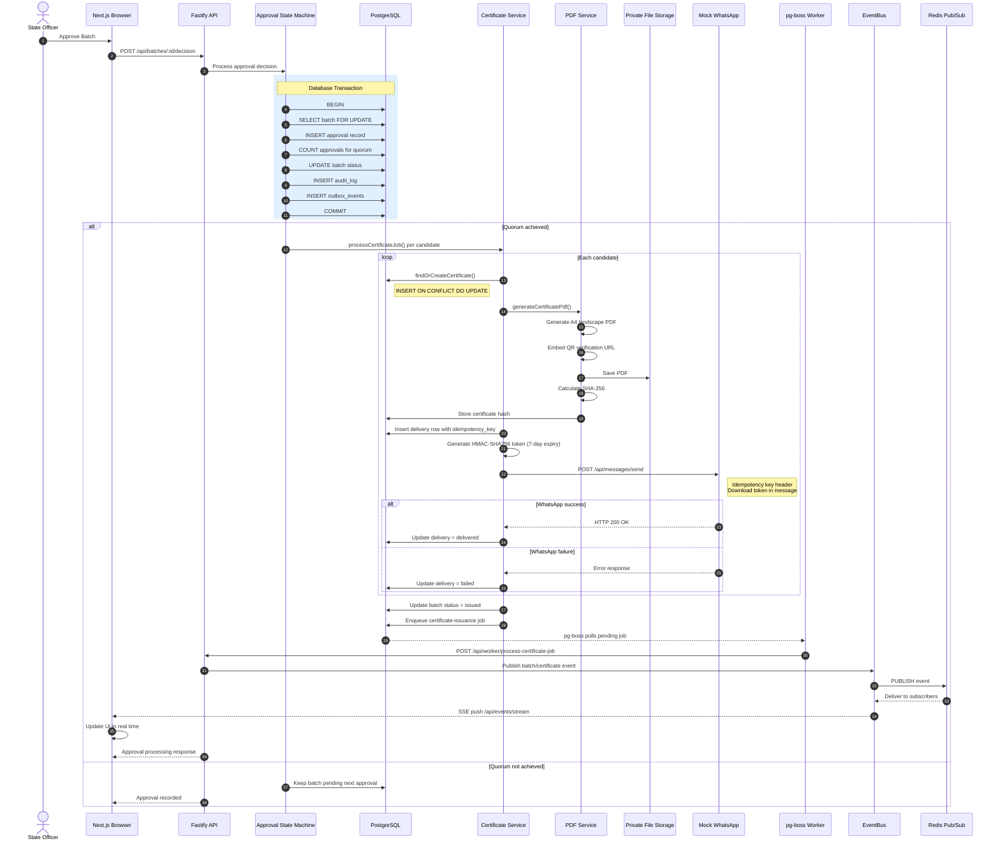

# CertiFlow: Skills Programme Certificate Issuance

Training centres upload passed batches. District officers, a quality team and the
state office approve them. Candidates get their certificate on WhatsApp, and anyone
can verify a certificate without logging in.

## 1. Requirements note

**Users:** Anika (training centre) · Dev, Meera, Kabir (district officers) ·
Neha (quality team) · Farah (state office) · Public verifiers (no login).

**Decisions where the brief was unclear:**

| Question | Our decision |
|---|---|
| Pipeline | draft → submitted → district_review → quality_review (large batches only) → state_review → approved → issued |
| What is a "big" batch? | The brief gives no number. We chose ≥ 50 candidates (`QUALITY_REVIEW_THRESHOLD`, configurable). Smaller batches skip quality review. |
| District decision | 2 distinct officers from the batch's district must approve |
| Send-back, then resubmit | `round` is incremented. Old approvals stay in the audit log but do not count toward the new round, because the data changed. |
| One officer rejects | Terminal. The centre must create a new batch. Send-back is the recoverable path. |
| Who can cancel a certificate | State office only, reason mandatory |
| SLA | Reminder, then escalation to the state office (15 s / 30 s in demo, configurable via env) |
| What the public sees | Masked name, course, issue date, certificate number, status. No phone or ID. |

## 2. Architecture

| Service | Tech | Role |
|---|---|---|
| web :3000 | Next.js | UI with persona switcher, live updates via SSE |
| api :4000 | Fastify | REST, JWT auth, approval state machine, PDF and WhatsApp dispatch |
| worker | Node + pg-boss | Issuance jobs and the SLA escalation cron |
| mock-whatsapp :4001 | Fastify | Fake provider with latency, failures, outage toggle, inbox UI |
| postgres :5432 | Postgres 16 (Docker) | All data and the job queue |
| redis :6379 | Redis 7 | Pub/sub for SSE, verify cache, rate limits |
| db-viewer :8080 | pgweb (Docker) | Web UI table viewer for local PostgreSQL database |

### Event Flow: Approval to WhatsApp Delivery

**Flow Steps:**
1. The final approval runs in one transaction: lock the batch row (`SELECT FOR UPDATE`), insert the approval, count the quorum, update status, write the audit log and an outbox event. Then commit.
2. After the commit, a certificate is created for each candidate (idempotent `INSERT ON CONFLICT`), an A4 landscape PDF with a QR code is generated and saved privately to `storage/private/certificates/`, and its SHA-256 is stored in PostgreSQL.
3. A delivery row is recorded with an idempotency key, and the WhatsApp dispatch endpoint is called with an HMAC-SHA256 signed expiring download link. Failures are marked `failed` in the deliveries table without failing the batch.
4. An event is published over Redis pub/sub and pushed to connected browser clients via Server-Sent Events (`/api/events/stream`), updating all dashboards in real time.

## 3. Key decisions

- **pg-boss:** the queue lives in the same Postgres as the data, so there is no extra infrastructure. Jobs survive crashes, retry with backoff, and singleton keys prevent duplicates.
- **SSE over Redis pub/sub:** one-way live updates, and it works across several API instances. Without Redis it falls back to in-process events.
- **Row lock for approvals:** `SELECT … FOR UPDATE` plus `UNIQUE(batch_id, round, step, officer_id)`. Concurrent approvals serialise, so the batch advances once.
- **Idempotency:** certificates use `INSERT … ON CONFLICT (candidate_id, course_name)`, and WhatsApp sends carry an idempotency key.
- **Verify cache:** Redis, short TTL. Cancelling deletes the cache key immediately.
- **Append-only audit log:** a database trigger blocks UPDATE and DELETE.
- **Stack:** Next.js, Fastify and plain Postgres in Docker differ from the suggested stack. We chose them for team familiarity, and Docker Postgres keeps the project runnable from a fresh clone with no cloud account. Migrations are plain SQL under `supabase/migrations/`.

## 4. Requirements and the tests that prove them

| Requirement | Enforcement | Test |
|---|---|---|
| Concurrent approvals move the batch once | Row lock plus unique constraint | `approvalWorkflow.test.ts` |
| Wrong role or district rejected | Checked from the JWT, not the body | `approvalWorkflow.test.ts` |
| Reject is terminal, send-back needs a reason | State checks, Zod | `approvalWorkflow.test.ts` |
| Resubmit starts a fresh round | `round` counter | `approvalWorkflow.test.ts` |
| 60 candidates, flaky provider: exactly 60 certificates | Idempotent creation and sends | `certificateIssuance.test.ts` |
| Cancelled certificate never shows as valid | Cache key deleted on cancel | `certificateIssuance.test.ts` |
| Download link can't be forged and expires | HMAC-SHA256 token | `certificateIssuance.test.ts` |
| Escalation fires once per level | `escalation_level` and `SKIP LOCKED` | `escalationAndTrace.test.ts` |
| Bad upload saves nothing, formulas neutralised | Validate-all-then-insert | `batchCandidateParser.test.ts` |

## 5. Security

Identity, role and district come only from the verified JWT. Request bodies use strict Zod schemas. Helmet, CORS allowlist, and Redis-backed rate limiting (100 requests/min/IP) are enabled. PDFs are stored privately and served only through signed expiring links. The public verify endpoint returns minimal data. **Not implemented: Row-Level Security.** Authorization is at the application layer only.

## 6. Observability

Every request has an `x-request-id` carried through the pino logs. Endpoints: `/healthz`, `/readyz` (DB and Redis), `/health`, Swagger at `/docs`, `GET /api/batches/:id/trace` (audit log, deliveries, outbox events), and `GET /api/batches/stuck` for the state office.

## 7. AI usage

[Fill in: which parts AI helped with, and how you verified them (tests, manual review, fresh-clone run), and what you rejected or changed.]

## 8. Known limitations and next steps

- No Row-Level Security.
- PDFs are on a local volume, not object storage.
- No retry screen for failed WhatsApp deliveries (they are only marked `failed`).
- The worker must be started separately in dev (`npm run dev:worker`).
- Seed data has one district and one centre.
- With Redis down, live updates only reach clients on the same API instance.
- The SSE token is passed in the query string and could appear in logs.
- No load test was run.
- Next steps: RLS, S3 storage, a real WhatsApp provider with an SMS or email fallback, a retry UI, multi-district seed data.